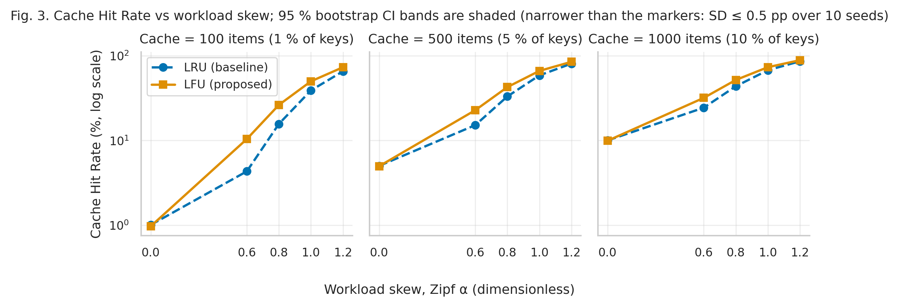
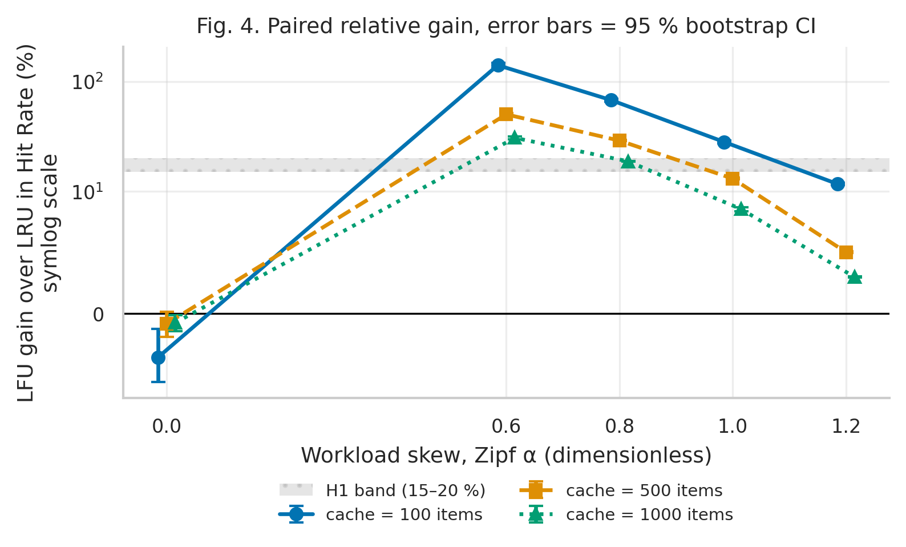
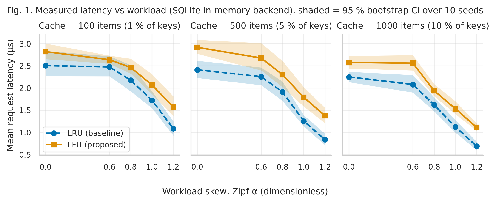
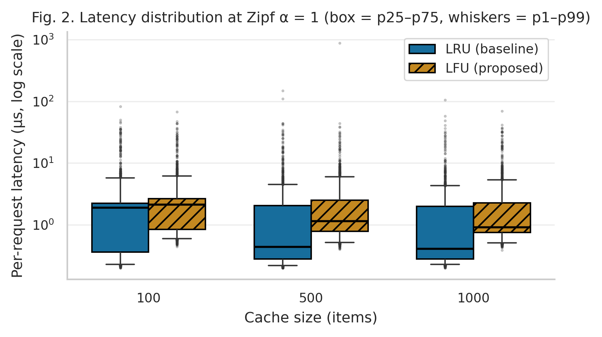
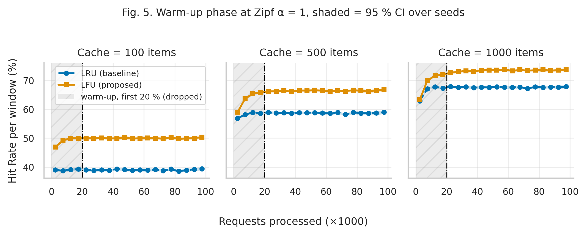

# Cache Algorithm Benchmark: LRU vs LFU under Zipfian Workloads

**Authors:** Azat Amir (3rd-year student, Narxoz University)
**Course:** Research Methods (Методы исследований)
**Repository:** https://github.com/Omor1M0ri/cache-algorithm-benchmark

## Research Question

Does the Least Frequently Used (LFU) eviction policy achieve a Cache Hit Rate that is
15–20 % higher (relative) than Least Recently Used (LRU) for a database-facing cache when
request popularity follows a Zipfian distribution?

- **H0:** Relative Hit Rate gain of LFU over LRU on a Zipfian workload (alpha = 1.0, cache = 1 % of keys) is < 15 %.
- **H1:** The gain is ≥ 15 % (expected 15–20 %).

## Overview

Two O(1) cache implementations (`src/cache.py`) sit in front of a database backend
(simulated or in-memory SQLite). A synthetic request stream is drawn from a Zipf law with
exponent alpha; both policies replay the *same* trace (paired design) over 10 random seeds.
The primary metric is Cache Hit Rate; the backend mean response time is a secondary
dependent variable. Full methodology: [`docs/methodology_card.md`](docs/methodology_card.md).

## Variables (summary)

| Type | Variables |
|---|---|
| Independent | eviction policy (LRU / LFU); cache size (100 / 500 / 1000 items); Zipf alpha (0.0, 0.6, 0.8, 1.0, 1.2) |
| Dependent | Cache Hit Rate (%) — primary; mean backend response time (ms) — secondary |
| Controlled | key space 10 000; 100 000 requests/run; 20 % warm-up; Python 3.12.7, pinned libs; fixed seeds |

## Planned Benchmarks

| ID | Workload | Cache sizes | Purpose |
|---|---|---|---|
| B0 | Uniform (alpha = 0.0) | 100, 500, 1000 | Negative control: no popularity skew, no expected LFU advantage |
| B1 | Zipf alpha = 0.6 | 100, 500, 1000 | Mild skew |
| B2 | Zipf alpha = 0.8 | 100, 500, 1000 | Moderate skew |
| B3 | Zipf alpha = 1.0 | 100, 500, 1000 | **Primary condition for H1** (cache = 100) |
| B4 | Zipf alpha = 1.2 | 100, 500, 1000 | Strong skew |

Each benchmark: 2 policies × 10 seeds.

## Repository Structure

```
cache-algorithm-benchmark/
├── data/
│   ├── raw/test_run.jsonl          # raw windows, phase = warmup | benchmark (6.9 MB)
│   ├── processed/metrics_summary.csv  # cleaned + aggregated metrics (30 conditions)
│   ├── processed/paired_gains.csv  # paired LFU-vs-LRU gains with 95 % CI
│   └── sample/sample_requests.csv  # 10-row smoke-test trace
├── docs/
│   ├── domain_model.md             # C4 model (Mermaid) with measurement points + LaTeX metrics
│   └── methodology_card.md         # variables matrix, metrics, baseline
├── notebooks/01_data_analysis.ipynb  # executed end-to-end (Restart & Run All)
├── reports/figures/                # fig1…fig5, each as .pdf (vector) + .png (300 DPI)
├── src/
│   ├── cache.py                    # LRUCache, LFUCache (O(1))
│   ├── workload.py                 # Zipf trace generator
│   ├── backend.py                  # simulated / SQLite backends
│   ├── benchmark.py                # measurement loop (run_single, run_logged)
│   ├── collect.py                  # Week 7–8 data collection → data/raw/test_run.jsonl
│   ├── process_data.py             # warm-up filtering, statistics, bootstrap CI
│   ├── visualize.py                # publication figures
│   ├── plot.py, main.py            # Task 2 pilot pipeline (results/full/)
├── configs/                        # config.yaml (pilot), benchmark_raw.yaml (Task 3), sample.yaml
├── scripts/run.sh                  # sample | full | collect | analyze
├── tests/test_cache.py
└── results/full/                   # Task 2 pilot results (simulated backend)
```

## System Requirements

- Python 3.12+ (or Docker 24+)
- ~500 MB RAM; data collection ≈ 75 s, analysis ≈ 15 s

## Quickstart

**Option A — Docker (2 commands):**
```bash
docker build -t cache-benchmark .
docker run --rm cache-benchmark          # smoke test on data/sample/
```

**Option B — local Python (3 commands):**
```bash
pip install -r requirements.txt
python -m pytest -q                      # unit tests
bash scripts/run.sh sample               # smoke test; writes results/sample/
```

Full experiment and analysis (Task 3):
```bash
bash scripts/run.sh collect   # ~75 s: 300 runs × 100 000 requests → data/raw/test_run.jsonl
bash scripts/run.sh analyze   # metrics_summary.csv + reports/figures/* + re-executes the notebook
```
Task 2 pilot (simulated backend): `bash scripts/run.sh full` → `results/full/`.

## Results & Discussion

**Setup.** 5 Zipf exponents × 3 cache sizes × 2 policies × 10 seeds = 300 runs of 100 000
requests against a real in-memory SQLite table; every request is timed with `perf_counter()`.
The first 20 % of each run (cold cache, `phase = warmup`) is discarded — Fig. 5 shows both
caches reach a plateau before that point. Uncertainty: 95 % percentile bootstrap CI over the
10 seeds (10 000 resamples, `seed = 42`). Full analysis:
[`notebooks/01_data_analysis.ipynb`](notebooks/01_data_analysis.ipynb).

### Baseline (LRU) vs Proposed (LFU), primary workload Zipf α = 1.0

| Cache size | Method | Hit Rate, % (Mean ± SD) | Latency, µs Median (p25–p75) | p95, µs | p99, µs | Mean latency, µs [95% CI] | Rel. HR gain, % [95% CI] | Errors, % |
|---|---|---|---|---|---|---|---|---|
| 100 | LRU (baseline) | 39.02 ± 0.12 | 1.90 (0.36–2.25) | 3.50 | 5.79 | 1.72 [1.54, 1.92] | — | 0.00 |
| 100 | LFU (proposed) | 49.98 ± 0.50 | 2.14 (0.84–2.67) | 4.14 | 6.17 | 2.07 [1.86, 2.31] | **+28.1 [+27.3, +28.9]** | 0.00 |
| 500 | LRU (baseline) | 58.71 ± 0.16 | 0.44 (0.28–2.04) | 3.35 | 4.48 | 1.25 [1.14, 1.39] | — | 0.00 |
| 500 | LFU (proposed) | 66.37 ± 0.27 | 1.15 (0.79–2.52) | 4.15 | 6.04 | 1.79 [1.58, 2.02] | +13.0 [+12.8, +13.3] | 0.00 |
| 1000 | LRU (baseline) | 67.60 ± 0.18 | 0.41 (0.28–1.99) | 3.45 | 4.29 | 1.12 [0.99, 1.28] | — | 0.00 |
| 1000 | LFU (proposed) | 73.37 ± 0.25 | 0.93 (0.75–2.26) | 3.63 | 5.37 | 1.53 [1.41, 1.70] | +8.5 [+8.4, +8.7] | 0.00 |

**Guardrail metrics:** 0 errors (exception or wrong payload) in 30 000 000 requests;
cache capacity never exceeded.

**Hypothesis.** At α = 1.0, cache = 100 the paired relative gain is **+28.1 %
(95 % CI 27.3–28.9 %)**; the lower bound is above 15 %, so **H0 is rejected**. The effect is
larger than the expected 15–20 % band.





**The gain depends strongly on the regime.** It is largest at moderate skew and small caches
(+140.7 % at α = 0.6, cache = 100, where LRU only reaches 4.3 %), and shrinks as the cache grows
or the skew becomes extreme (+3.0 % at α = 1.2, cache = 1000), because both policies then keep
the same hot set. The uniform negative control (α = 0) shows no LFU advantage
(−3.6 … −0.8 %), as expected.





**Latency is the opposite story — and that is a backend effect.** With an *in-memory* SQLite
table a miss costs only ~3 µs, comparable to the Python bookkeeping of LFU's frequency
buckets, so measured mean latency of LFU is 8–68 % *higher* than LRU (Fig. 1). The
break-even miss penalty, t\*<sub>db</sub> = ΔT / ΔHR, is only 2.7–16.6 µs across all skewed
conditions. Any networked database (round trip ≈ 0.1–5 ms) is far above that: with the
5 ms miss cost from the pilot model, LFU lowers expected latency by 6–22 % for α ≥ 0.6
(`pdp.break_even()` in the notebook).



**Threats to validity.** The independent-reference Zipf model has no popularity drift, which
favours LFU; real traces with shifting hot sets may reduce the gain. Latency is measured in a
single Python process on a shared cloud VM (wide CI bands in Fig. 1); hit-rate results are
deterministic given the seed and backend-independent (they match the Task 2 pilot exactly).

## Domain Model

C4 System Context, Container and Component diagrams (Mermaid) with the five measurement
points M1–M5 highlighted, plus LaTeX definitions of the metrics and the decision rule:
[`docs/domain_model.md`](docs/domain_model.md).

## Citation

```
Amir, A. (2026). Cache Algorithm Benchmark: LRU vs LFU under Zipfian Workloads.
Narxoz University, Research Methods course project.
https://github.com/Omor1M0ri/cache-algorithm-benchmark
```

## License

MIT — see [LICENSE](LICENSE).
