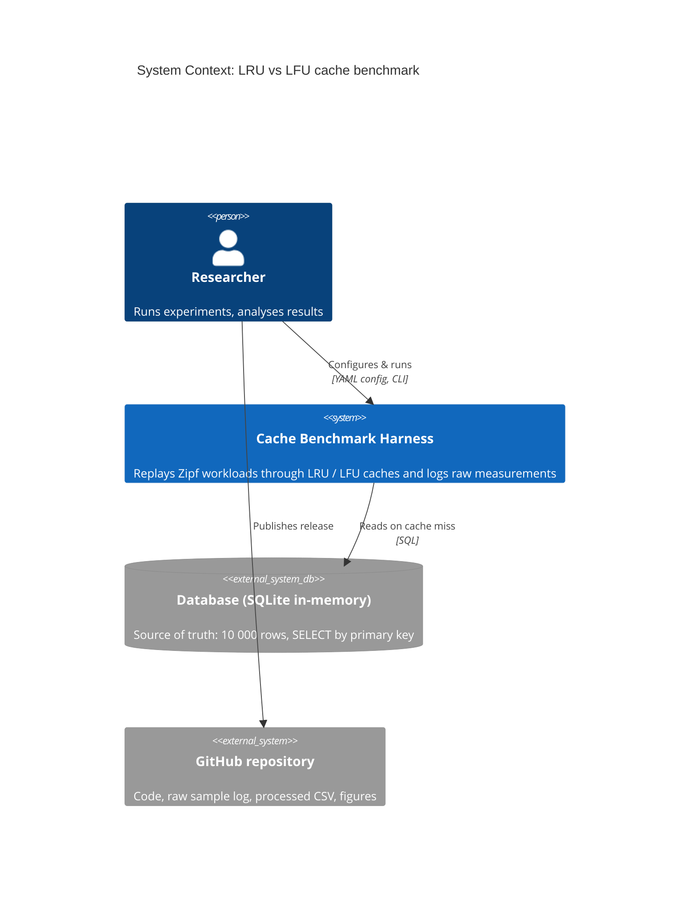
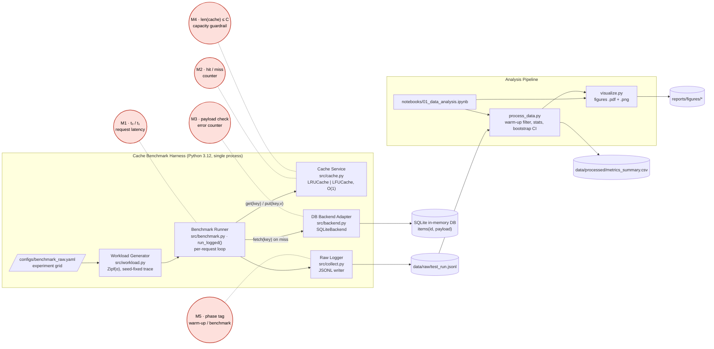
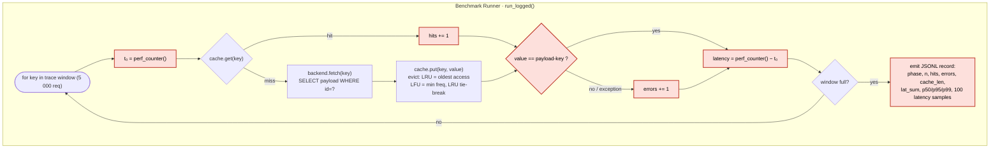

# Domain Model — Cache Algorithm Benchmark (C4 Model, SE track)

The system under test is a **read-through cache in front of a database**. The benchmark
harness replays a synthetic Zipf request stream through two interchangeable cache
policies (LRU = baseline, LFU = proposed) and records metrics at clearly defined
measurement points (**M1–M5**, red nodes below).

## Level 1 — System Context

## Level 2 — Containers

## Level 3 — Components of the measurement loop

## Measurement points

| ID | Where | What is measured | Unit | Used for |
|---|---|---|---|---|
| M1 | Runner, around each request | wall-clock latency `perf_counter()` (lookup + DB fetch on miss) | µs | Fig. 1, Fig. 2, p50/p95/p99 |
| M2 | Cache `get()` result | hit / miss | count → % | Hit Rate (primary metric), Fig. 3–5 |
| M3 | Response validation | exception or wrong payload | count → % | **Guardrail:** error rate must be 0 % |
| M4 | Cache size after each window | `len(cache) ≤ capacity` | bool | **Guardrail:** capacity never exceeded |
| M5 | Logger | window start < 20 % of trace → `warmup` | tag | Warm-up filtering, Fig. 5 |

## Formal metric definitions

For policy $p \in \{\text{LRU}, \text{LFU}\}$, seed $s$, and the set $B$ of benchmark-phase requests:

$$HR_{p,s} = \frac{100}{|B|}\sum_{i \in B} \mathbb{1}[\text{hit}_i], \qquad
G_s = \frac{HR_{\text{LFU},s} - HR_{\text{LRU},s}}{HR_{\text{LRU},s}} \cdot 100\,\%$$

$$\bar T_{p,s} = \frac{1}{|B|}\sum_{i \in B} \left(t_{1,i} - t_{0,i}\right), \qquad
\text{CI}_{95}(\bar G) = \left[Q_{2.5}\!\left(\bar G^{*}\right),\; Q_{97.5}\!\left(\bar G^{*}\right)\right]$$

where $\bar G^{*}$ are 10 000 bootstrap means of $\{G_s\}_{s=0}^{9}$ (`seed = 42`).
**Decision rule:** reject $H_0$ iff the lower bound of $\text{CI}_{95}(\bar G) \ge 15\,\%$ at α = 1.0, C = 100.
